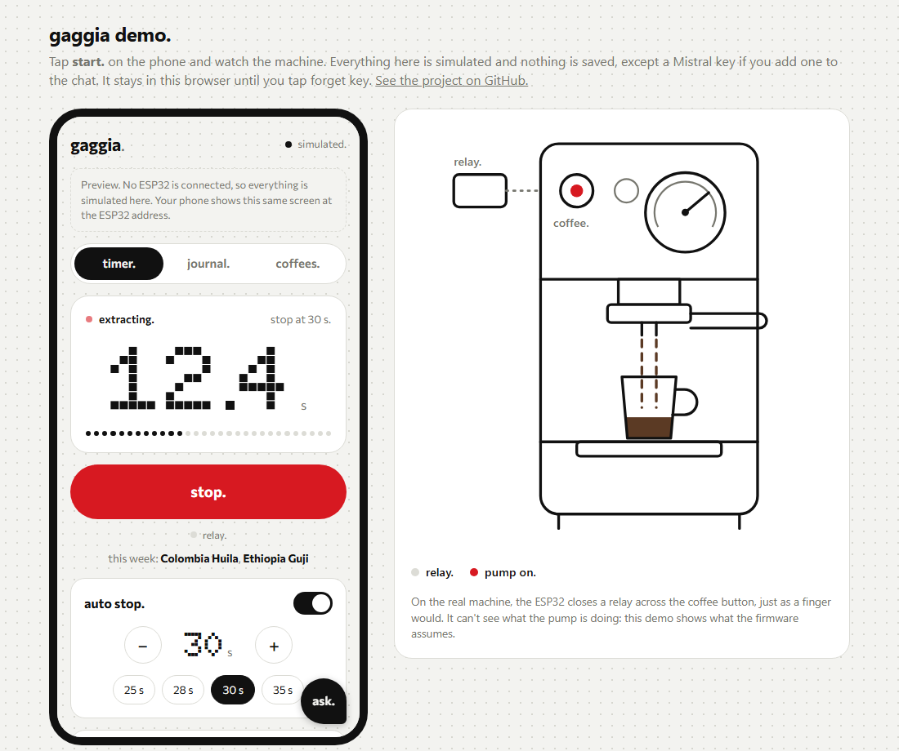

# Gaggia Control and Log

An ESP32 add-on that gives a Gaggia Carezza Deluxe a phone app. Start and stop shots, stop automatically
at a time limit, and keep a brew journal, all from your home WiFi with no cloud or account.

> [!WARNING]
> **This project modifies a 230 V machine, and its button board is not isolated from mains.** Unplug the
> machine before touching anything inside it. The ESP32 connects only through a relay's dry contacts. Do
> this at your own risk: the software comes with no warranty, and the changes may void the machine's.

> [!IMPORTANT]
> **For home use, by one device at a time.** It isn't designed for commercial use or coffee shops. If two devices
> save changes around the same time, one can overwrite the other's coffee list.

**[Try the demo in your browser](https://yiannosparanomos.github.io/gaggia-control-and-log/)**: the real app beside a
simulated machine, with no hardware needed.

<a href="https://yiannosparanomos.github.io/gaggia-control-and-log/"></a>

## What it does

- **Timer:** start and stop from the phone, with a live clock and auto-stop from 5 to 60 s.
- **Safety stop:** every timed shot stops at 60 s, even if the phone goes to sleep.
- **Journal:** dose, yield, ratio, grind, six taste scales and notes, in a list or a calendar.
- **Coffees:** your bags, how many days off roast, and which ones you're drinking this week.
- **Your data stays on the ESP32:** download or restore it as one backup file.

## Quick start

You need Node.js, [PlatformIO](https://platformio.org/install/cli), an ESP32 DevKit and the wiring in
[docs/hardware.md](docs/hardware.md).

```sh
cp firmware/src/secrets.example.h firmware/src/secrets.h   # then fill in your WiFi
cd web
npm install
npm run dev                                                # http://localhost:5173/?sim needs no hardware
```

To build and upload the firmware, see [docs/development.md](docs/development.md).

## Where to find things

| Path | What's there |
|---|---|
| [`docs/`](docs/README.md) | Start here: hardware, architecture, API, development, decisions, roadmap |
| [`firmware/`](firmware/) | The C++ running on the ESP32 (PlatformIO, Arduino framework) |
| [`web/`](web/) | The phone app (plain HTML, CSS and JS, built with Vite and embedded in the firmware) |
| [`tools/`](tools/) | Checks, firmware upload and build helpers |
| [`todo.md`](todo.md) | Known bugs and next steps |

## Licence

[MIT](LICENSE) for this project's code and docs. Embedded fonts and the firmware framework keep their own
licences: see [THIRD_PARTY_NOTICES.md](THIRD_PARTY_NOTICES.md).
