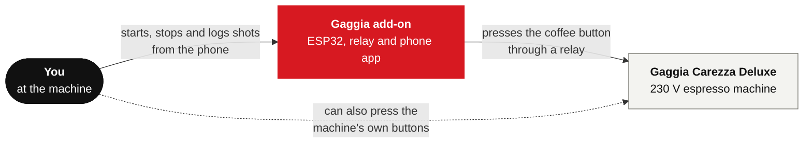
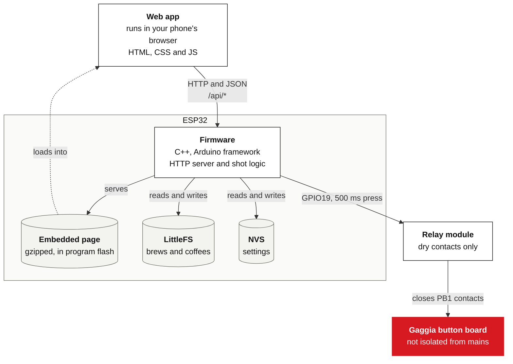
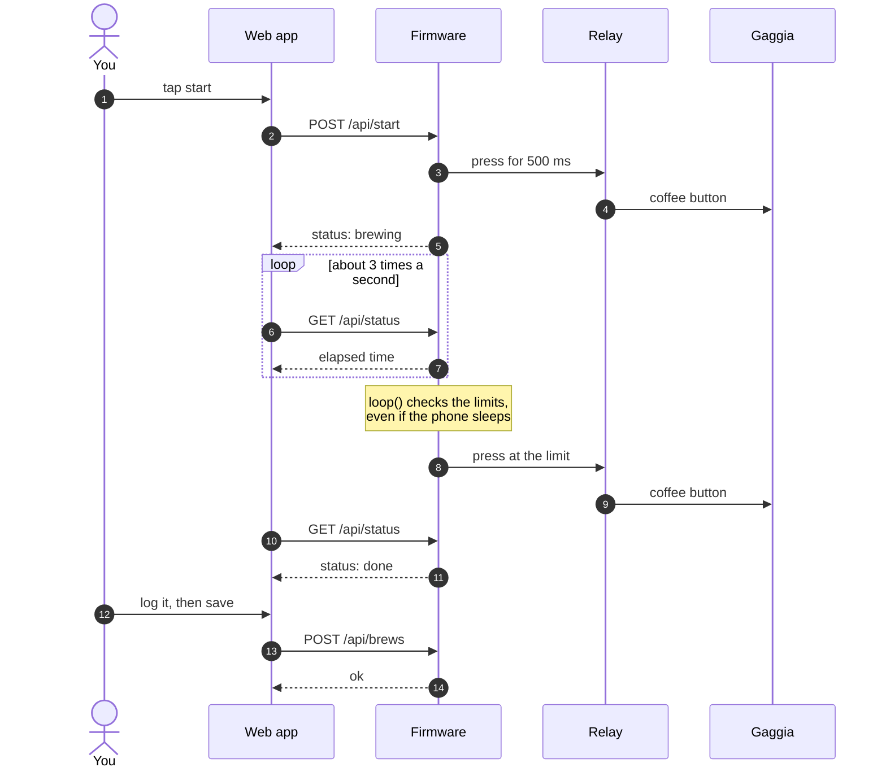
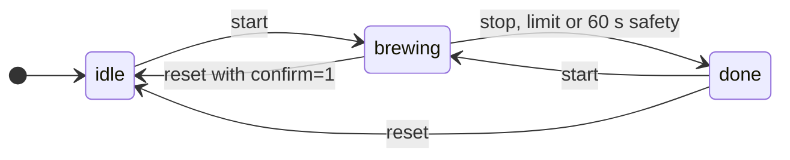

# Architecture

This page starts with the big picture and zooms in. Stop reading as soon as you know enough. The product
views follow the [C4 model](https://c4model.com): context, containers, then components.

| Section | Answers |
|---|---|
| [1. Context](#1-context) | What is this, and what does it touch? |
| [2. Containers](#2-containers) | What are the main parts, and how do they talk? |
| [3. Components](#3-components) | What's inside each part? |
| [4. How a shot runs](#4-how-a-shot-runs) | What happens, step by step? |

## 1. Context

You use your phone. The add-on presses the machine's coffee button for you, exactly as a finger would. It
can't see what the machine is doing, and it works with no internet.

## 2. Containers

The ESP32 runs the firmware and also serves the app. The app runs in your phone's browser and asks the
firmware for its status about three times a second. All heavy work, such as stats and the calendar, happens
in the browser, because the ESP32 has little memory to spare.

The app is embedded in the firmware rather than stored on LittleFS, because uploading a filesystem image
would wipe the journal. See [decisions.md](decisions.md#software).

## 3. Components

### Firmware

The code is in [`main.cpp`](../firmware/src/main.cpp) and [`shot.h`](../firmware/src/shot.h). For the exact
routes, see [api.md](api.md).

- **Shot rules** decide when the relay may be pressed, including the 1 s cooldown and the time limits. They
  have no Arduino code, so they can be tested on a PC. `main.cpp` supplies the clock and clicks the relay.
- **`loop()`** checks the limits continuously on the ESP32, so a shot still stops if the phone sleeps.
- **WiFi updates** only run outside a shot, because an update blocks `loop()` and so would block the stops.
- **Journal storage** writes a replacement to a temp file first, checks its size, then swaps it in. A
  failure leaves the old file in place.

### Web app

[`web/src/main.js`](../web/src/main.js) is one file with the sections below.

With `?sim`, the same app runs with a JavaScript imitation of the firmware, so it needs no hardware. It
looks identical, but it can't show the real relay, flash storage or timing.

## 4. How a shot runs

The firmware's view of a shot:

These states are what the firmware assumes, not what it measures, because nothing reports the machine's
real state. If someone uses the machine's own button, they can disagree. See
[development.md](development.md#the-esp32-cant-see-the-machine).
