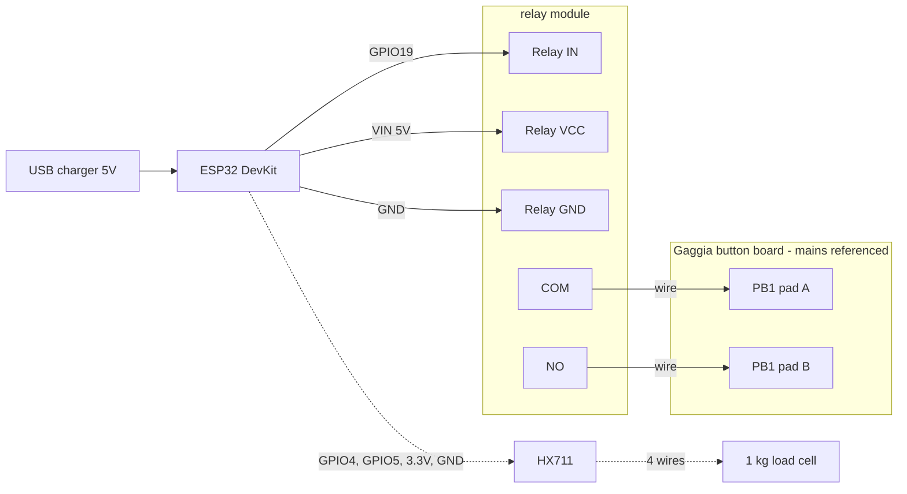
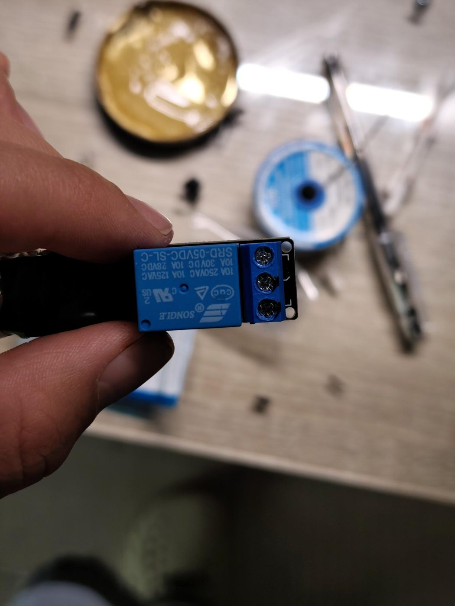
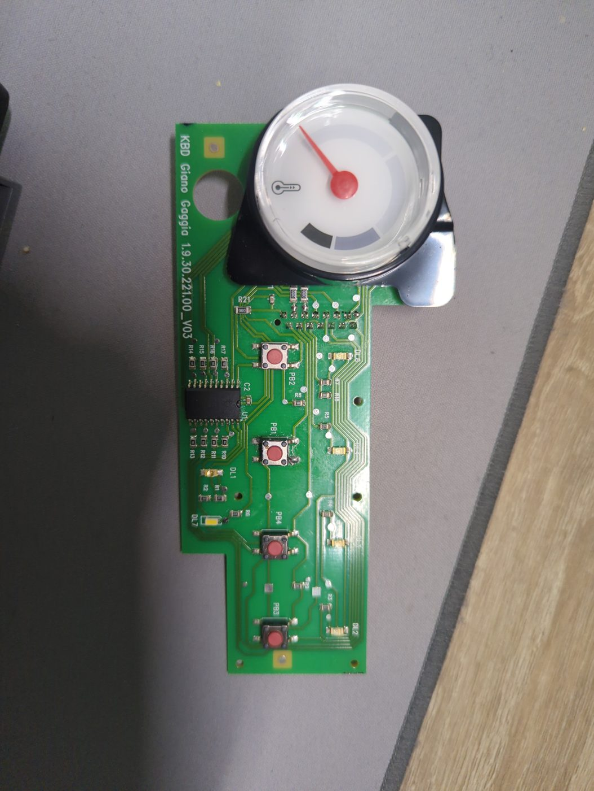
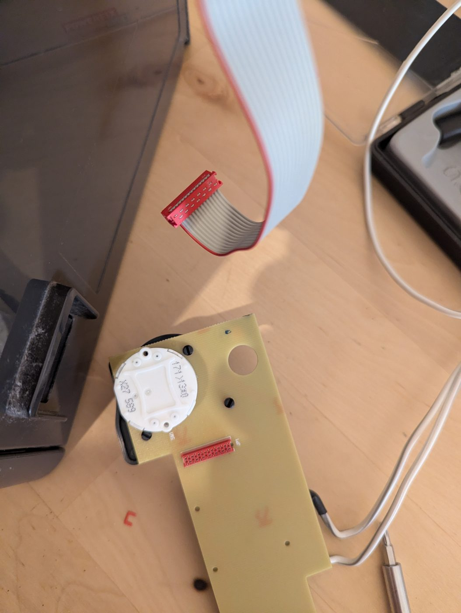
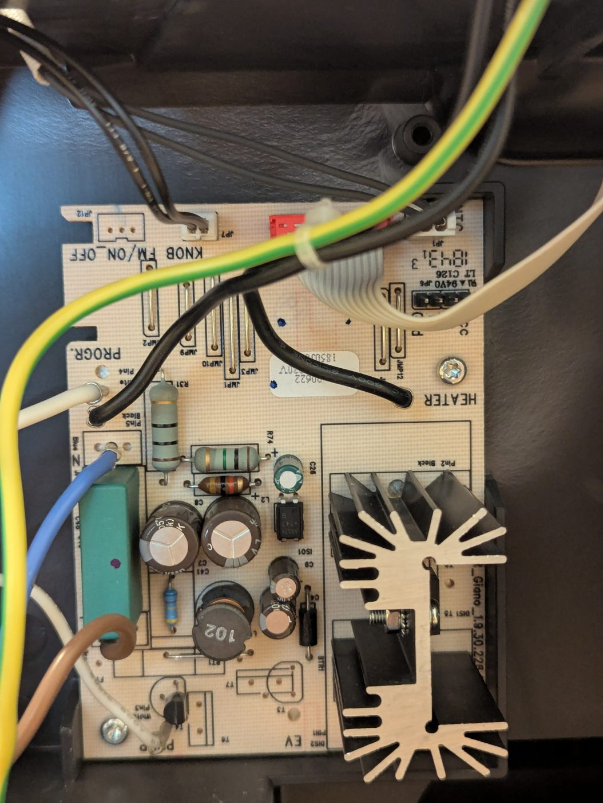
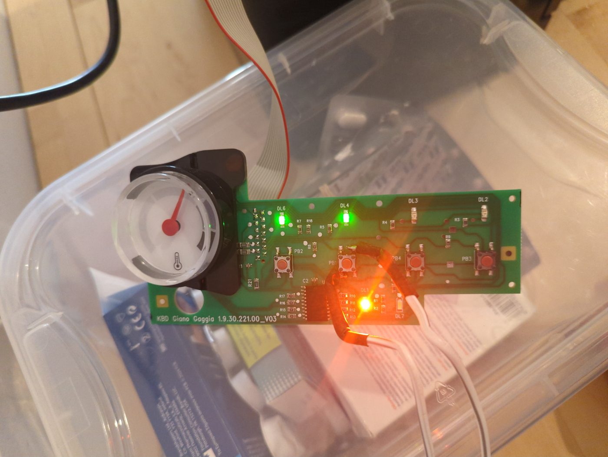
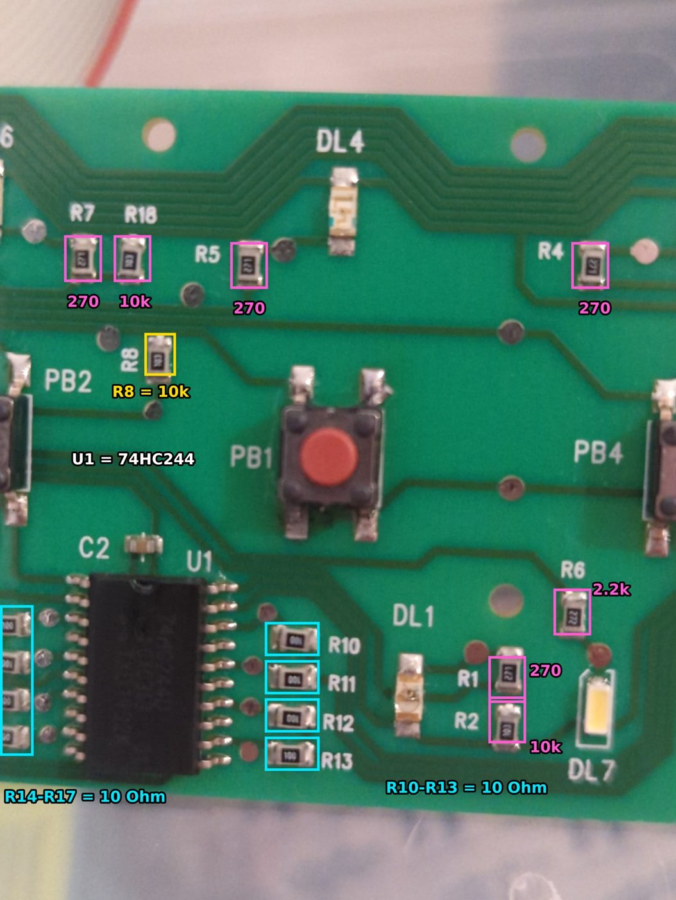
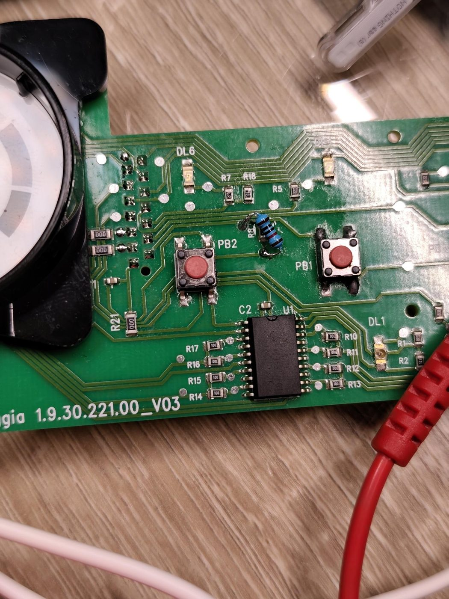
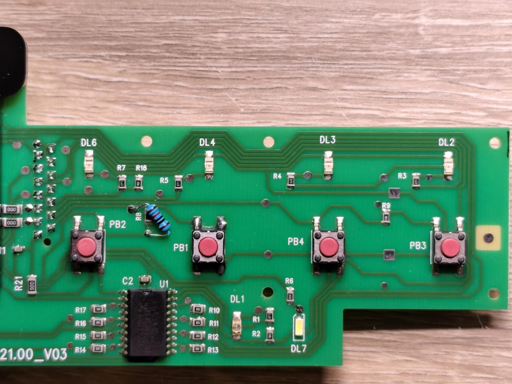

# Hardware

How the ESP32 talks to a **Gaggia Carezza Deluxe**, what the inside of the machine looks like, and
the repair that got the machine's own buttons working reliably again.

> [!WARNING]
> The Gaggia's button board is **not isolated from 230 V mains**. Probing it while the machine was
> plugged in tripped the house RCD. Unplug the machine before touching anything inside it. The ESP32
> connects to the machine **only** through the dry contacts of a relay.

---

## Parts

| Part | Notes |
|---|---|
| ESP32 DevKit V1 (ESP32-D0WD-V3, 4 MB flash) | Runs the firmware and the web app. Powered from a USB phone charger, kept outside the machine |
| 1-channel 5 V relay module, optocoupled (Songle SRD-05VDC-SL-C) | Presses the coffee button. Active LOW |
| HX711 load cell amplifier | For the scale. Not used by the current firmware |
| 1 kg bar load cell | For the scale. 1 kg gives much better resolution than 5 kg for a ~40 g shot |
| Thin insulated wire, flux, solder, 10 kΩ 1% through-hole resistor | The resistor was for the R8 repair below |

Bought from Grobotronics (Greece).

## Wiring

| From | To | Notes |
|---|---|---|
| Relay IN | **GPIO19** | `LOW` = relay on |
| Relay VCC | VIN (5 V) | |
| Relay GND | GND | |
| Relay **COM** | PB1 pad | Middle screw terminal |
| Relay **NO** | other PB1 pad | The outer terminal that does **not** beep to COM when the relay is off. NC stays empty |
| HX711 VCC / GND | 3.3 V / GND | Scale (optional) |
| HX711 DT / SCK | GPIO4 / GPIO5 | Scale (optional) |
| Load cell red / black / white / green | E+ / E− / A− / A+ | A+ and A− are swapped on this build, corrected with a negative calibration factor |

**GPIO18 is solder-bridged to GPIO19** on this particular ESP32, so the firmware keeps GPIO18 as an
input and never drives it.

### Which PB1 pads

PB1 is a 4-leg tactile switch. Two legs on the same side are joined inside the switch, so they always
beep. Use a **diagonal pair** (top right and bottom left on this board): with a multimeter in
continuity mode they must be silent when idle and beep only while PB1 is pressed.

---

## Inside the machine

The Carezza Deluxe has two boards connected by a ribbon cable:

- **Main board** ("Giano 1.9.30.22"): power supply, the microcontroller, and the switching for pump
  and heater.
- **Button board** ("KBD Giano Gaggia 1.9.30.221.00_V03"): the four buttons, the LEDs and the
  temperature gauge. It has no processor of its own.

| | |
|---|---|
|  |  |
| Button board, front | Button board, back, with the ribbon cable |
|  |  |
| Main board | Button board powered on the bench, relay wires on PB1 |

### Button board map

| Part | What it is |
|---|---|
| **PB1** | Coffee (pump) button. The relay is wired here |
| **PB2** | On/off |
| PB3, PB4 | The other two functions (not needed for this project) |
| DL1–DL7 | Status LEDs |
| **U1** | NXP **74HC244D**, an octal buffer. Not a microcontroller. It is **not** in the on/off button's path |
| R10–R17 | 10 Ω (code `100`), around U1 |
| **R8** | 10 kΩ (code `103`), in series between PB2 and the ribbon cable |
| R1, R4, R5, R7 | 270 Ω (`271`), LED resistors |
| R2, R18 | 10 kΩ (`103`) |
| R6 | 2.7 kΩ (`272`) |
| Gold square pads | Mounting / chassis contact. Not connected to the circuit's ground |

The temperature gauge is driven through the ribbon by the main board. When the machine is plugged in,
the needle sweeps once: that's a quick way to see the main board is alive.

---

## The repair: on/off button stopped working

**Symptoms (over several months):** the machine sometimes turned itself on or off, sometimes ignored
the on/off button, and at one point only responded while a finger touched the board. Re-seating the
board's screws or adding a ground wire seemed to help, but never for long.

**What was ruled out**, all with the machine unplugged:

1. Ribbon cable, pin-to-pin continuity: OK. Orientation: red stripe on pin 1.
2. All four buttons: continuity only when pressed. OK.
3. Every resistor on the button board measured in place. All fine except **R8**.
4. Main board fusible resistor R31: OK. The gauge sweep also showed the main board was alive.
5. U1 (74HC244D): continuity tracing showed only PB2's **ground** leg goes to U1. The signal leg goes
   PB2 → R8 → ribbon.

**The cause:** R8 is marked `103` (10 kΩ) but measured **46.7 kΩ**. A resistor measured in circuit
can read lower than its value, never higher, so it had drifted. Reflowing its joints didn't change it.

**What didn't work:** soldering a new 10 kΩ **in parallel** with the old R8 gave ~8.2 kΩ, and the
button stopped responding completely.

**What fixed it:** removing the old SMD R8 entirely and leaving a single **10 kΩ 1% through-hole
resistor** across R8's two vias (measured 9.9 kΩ on the board). The button has worked since.

**Why the exact value matters:** R8 sits in series with the button, so the main board doesn't just see
"pressed / not pressed". It most likely reads a voltage set by R8 and a resistor on its own side
(a resistor-ladder style input), and only accepts the on/off press inside a window around 10 kΩ.
46.7 kΩ and 8.2 kΩ both fall outside it. As R8 drifted, presses were recognised less and less often.

**Lessons**

- Measure first, change one thing at a time, and keep a known state you can go back to.
- On this board, resistor **values** carry meaning. Replace like for like, and don't parallel a new
  part over an old one.
- "It works when I touch it" usually means a high-impedance input whose resistor has failed, not a
  grounding problem.

### Unexplained: U1 pins 7 and 9

U1's pins 7 and 9, which are outputs in the standard pinout, beep to ground. This may just be how
unused channels are tied. It has caused no problems so far, but it's worth remembering if the LEDs ever
misbehave.

---

## The scale (not in the current firmware)

The HX711 and load cell worked in April 2026, stopping the shot at 40 g. The code is in
[legacy/](legacy/).

**Calibration:** the factor came out at **−756.8** with a 71.4 g reference weight. It's negative because
A+ and A− are swapped. To recalibrate: `new_factor = old_factor × displayed_weight / actual_weight`.

**Problems already solved**

- The ESP32 boot-looped with the HX711 disconnected. Use `wait_ready_timeout(3000)`.
- Readings drifted upward because of bad solder joints on the load cell wires.

**Needed to bring it back**

- Rigid mounting with M3 screws, not zip ties or hot glue.
- Some waterproofing for the load cell.
- A platform. A 2–3 mm aluminium sheet was being considered.
